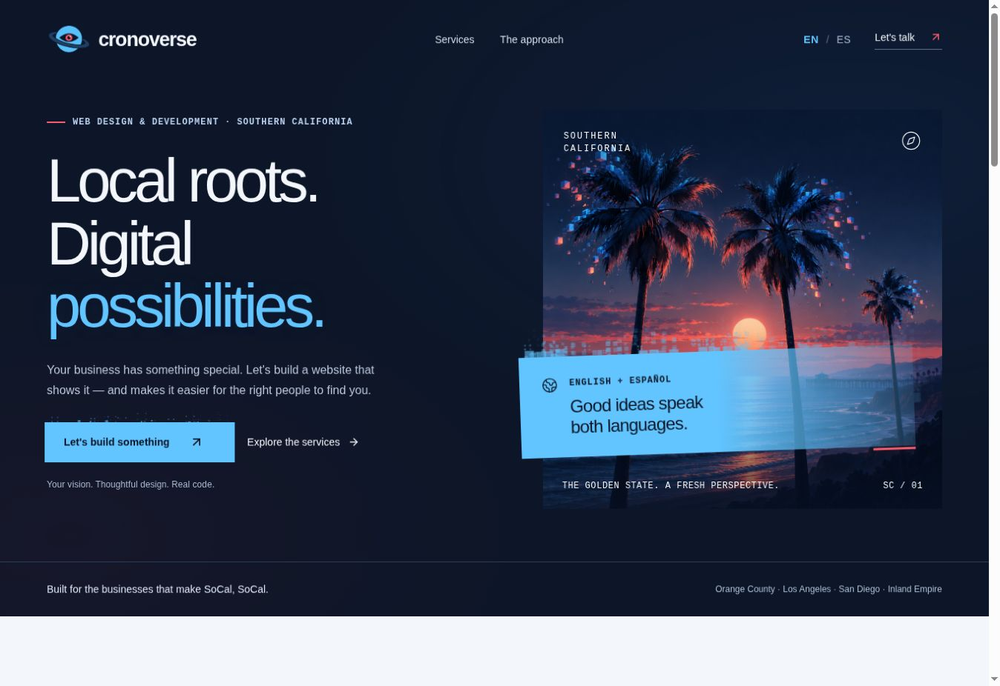

# Cronoverse Web Studio

Bilingual web design and development studio website for Southern California.
Contains the approved animated frontend, original artwork, interactive examples,
and the dedicated Django backend.

This branch connects the two: the animated palm-tree hero and the inquiry form
submit through a same-origin server route to Django, with Mailjet emails, a
consent-gated Google Analytics tag, and the Google Analytics admin dashboard.
Read [the integration notes](docs/FRONTEND_INTEGRATION.md) for what was combined,
what changed, the test results, and the configuration still to do.

## Current experience

- Page flow: hero → services (websites, business software, automation) → interactive examples →
  why Cronoverse → process → project inquiry. Copy and rationale: [docs/MARKETING_OVERHAUL.md](docs/MARKETING_OVERHAUL.md).
- English at `/`, Spanish at `/?lang=es`. The server renders the chosen language (from `?lang=`
  or the remembered `cronoverse-language` cookie), so there is no flash of the other language,
  and each language has its own title, description, canonical URL, and hreflang links.
- Animated palm-tree hero: six painted scenes (evening, sunny, night, pre-dawn,
  rain, and "somewhere else") with voxel fumes drifting off the palms. It pauses
  on hover and offscreen. Visitors whose system asks for reduced motion get a calmer version
  (half the speed and particles) instead of a still frame, and a Pause/Play button on the art
  lets anyone stop it; the choice is remembered.
- Approved Saturn-eye icon: blue planet, red iris, dark navy ring.
- Interactive inventory, landing page, business profile, order grid, and charts.
- Inquiry form in English and Spanish, validated in the browser (translated messages) and on
  the server, saved by Django; service cards preselect the matching service,
  with an English or Spanish welcome email and an owner notification.
- Google Analytics only after the visitor allows it, with a way to change the choice. Events:
  `hero_cta_click`, `service_cta_click`, `demo_interaction`, `contact_form_start`,
  `language_change`, and `generate_lead` (confirmed inquiries only); no form content is sent.
- `robots.txt`, `sitemap.xml`, Open Graph/Twitter previews (`public/cronoverse-og.jpg`), and
  `Organization` structured data.

The carousel uses sample data and component state. It does not create real
products, orders, sales, or appointments.



## Stack

React 19, TypeScript, Vinext/Vite with Next.js-style App Router routes, Tailwind,
Shadcn components, Embla, Recharts, Cloudflare Workers, D1, and Drizzle.
Use the package scripts, not `next dev`.

## Run locally

Requirements: Node.js 22.13+ and pnpm 11.25.0 (pinned in `package.json`).

```sh
git clone https://github.com/crono117/cronoverse_web_studio.git
cd cronoverse_web_studio
corepack enable
corepack pnpm install --frozen-lockfile
corepack pnpm db:migrate:local
corepack pnpm dev
```

Open the printed local URL, normally `http://localhost:5173`. Local development
requires no Cloudflare login, API keys, or production database access. Local D1
state lives in ignored `.wrangler/state` files.

To submit inquiries, also run the Django backend and its email worker and copy
`.dev.vars.example` to `.dev.vars`; see
[Run locally](docs/FRONTEND_INTEGRATION.md#run-locally). Without Django the form
shows its error and keeps what was typed.

Clean clones automatically select the portable execution profile. The optional
`.sites-runtime` configuration belongs to managed ChatGPT previews and is not
committed. The managed `install:ci` helper is not needed for a normal local clone.

## Checks and build

```sh
corepack pnpm test         # 8 proxy tests and 8 analytics tests
corepack pnpm typecheck
corepack pnpm lint
corepack pnpm build
corepack pnpm start
backend/.venv/bin/python scripts/smoke-inquiries.py
```

The build produces a Worker and assets under `dist/`. `start` runs that output
locally with Wrangler; use its printed URL. It needs `.dev.vars` copied to
`dist/server/` after each build (see the integration notes). Build output and
local database files are not tracked. The smoke script runs the proxy against a
temporary Django database and a local SMTP receiver.

## Dedicated Django backend

The browser posts to this site's own `POST /api/inquiries` route
(`app/api/inquiries/route.ts`, `lib/inquiry-intake.ts`). It checks Origin, size,
JSON, fields, and the honeypot, then forwards to Django with the server-only
`INQUIRY_API_KEY`. The form reports success only after Django acknowledges that
the inquiry was saved, reuses a UUID for unchanged retries, and keeps the visitor's
text on any failure. There is no D1 fallback; historical D1 data is retained.

The separate Python service in `backend/` provides authenticated inquiry intake,
Django/Jazzmin admin, and durable email jobs. Its worker sends an English/Spanish
welcome and an owner notification through Mailjet SMTP, both from
`Cronoverse Web Studio <info@cronoverse.online>`. Owner alerts go to
`lh@cronoverse.online`. The staff-only `/admin/analytics/` page reads GA4 visitors,
sessions, page views, inquiry conversions, trends, sources, and devices.

Read [the backend handoff](docs/BACKEND_HANDOFF.md) for the request contract,
and [Django setup](docs/DJANGO_BACKEND.md) to run the API and email worker without
the frontend. [Google Analytics setup](docs/GOOGLE_ANALYTICS.md) covers the
reporting credentials and the consent-gated tracking on the website.
Real Mailjet delivery and Google reporting require private server configuration.

## Source map

| Path | Purpose |
| --- | --- |
| `app/page.tsx` | Server entry: per-language metadata (title, canonical, hreflang, Open Graph) and JSON-LD |
| `components/home.tsx` | Landing page, translations, language selection, inquiry form |
| `lib/site.ts` | Site URL, language rules, page metadata copy, and structured data |
| `proxy.ts` | Picks the page language before rendering (`?lang=` then cookie) |
| `app/robots.ts`, `app/sitemap.ts` | `robots.txt` and `sitemap.xml` with both language URLs |
| `components/hero-scenes.tsx` | Hero scene layers, scheduler, and bilingual labels |
| `lib/cronoverse-fumes.ts` | Canvas engine for the palm and causeway fumes (`@ts-nocheck` on purpose) |
| `lib/inquiry-intake.ts` | Server-side validation and forwarding to Django |
| `lib/analytics.ts`, `components/google-analytics.tsx` | Consent, GA4 tag, and the `generate_lead` event |
| `tests/` | Proxy and analytics tests (`pnpm test`) |
| `scripts/smoke-inquiries.py` | Loopback proxy, Django, and SMTP smoke test |
| `Dockerfile`, `backend/Dockerfile`, `deploy/` | Container images, the production Compose stack, Caddy routes, and the deployment runbook |
| `app/globals.css` | Approved styling and responsive layouts |
| `components/capability-showcase.tsx` | Five interactive sample applications |
| `components/dust-surface.tsx` | Canvas particle accents |
| `app/api/inquiries/route.ts` | Same-origin inquiry endpoint that forwards to Django |
| `backend/` | Django API, admin, GA4 reports, and Mailjet email worker |
| `docs/FRONTEND_INTEGRATION.md` | How the frontend and backend were combined, results, and remaining setup |
| `docs/HOME_MACHINE_HANDOFF.md` | The original integration instructions |
| `db/schema.ts`, `db/raw.ts` | Database schema and D1 access |
| `drizzle/` | Versioned database migrations |
| `wrangler.local.jsonc` | Local-only migration configuration |
| `public/hero-*.webp`, `public/hero-*-800.webp` | Served hero scenes (WebP, full and 800px wide); the `.png` files are the masters |
| `public/cronoverse-og.jpg` | 1200×630 social preview image |
| `public/brand/` | Approved bilingual brand pack: navbar/footer logos (SVG + PNG), mark, favicons, web manifest. See `ASSETS.md` |
| `public/cronoverse-saturn-eye-navy.png` | Previous brand mark, kept for history |

## Hosting and provenance

`https://cronoverse.online/` runs as Docker containers (frontend, Django, email worker,
PostgreSQL) in `/opt/cronoverse` on a DigitalOcean droplet, behind that server's existing
Caddy. Releases are built on a workstation and streamed with `deploy/ship.sh`; each image is
tagged with its Git commit. See `deploy/README.md` for the procedure and rollback. GitHub
pushes **do not deploy** the live website.

`.openai/hosting.json` records the original ChatGPT Sites project this code was exported
from. It is historical and is not the current host.

GitHub Actions checks the Django backend against PostgreSQL, and the frontend
(tests, type check, lint, build) plus the loopback SMTP smoke. The Django web and
email-worker processes still need their own Python host, and the Site needs the
`INQUIRY_BACKEND_URL` and `INQUIRY_API_KEY` runtime settings before this frontend
is published; this branch deploys neither and changes nothing live.

The database ID in the local configuration is an emulator placeholder. Hosting
outside Sites requires a deliberate deployment configuration and real bindings.
`app/chatgpt-auth.ts` depends on trusted identity headers from Sites and is not
standalone production authentication.

This is a snapshot of approved Sites source commit
`3efc509ea500e4b215415844282e5f17ce8f113e`, plus setup documentation and local
commands. Production inquiry records, credentials, and local runtime state are
not included.

Requested domain: `cronoverse.online`. Preserve `xenos.cronoverse.online` and
existing mail records during future DNS work. See [ASSETS.md](ASSETS.md) for
artwork notes. Third-party license notices remain alongside vendored code.
