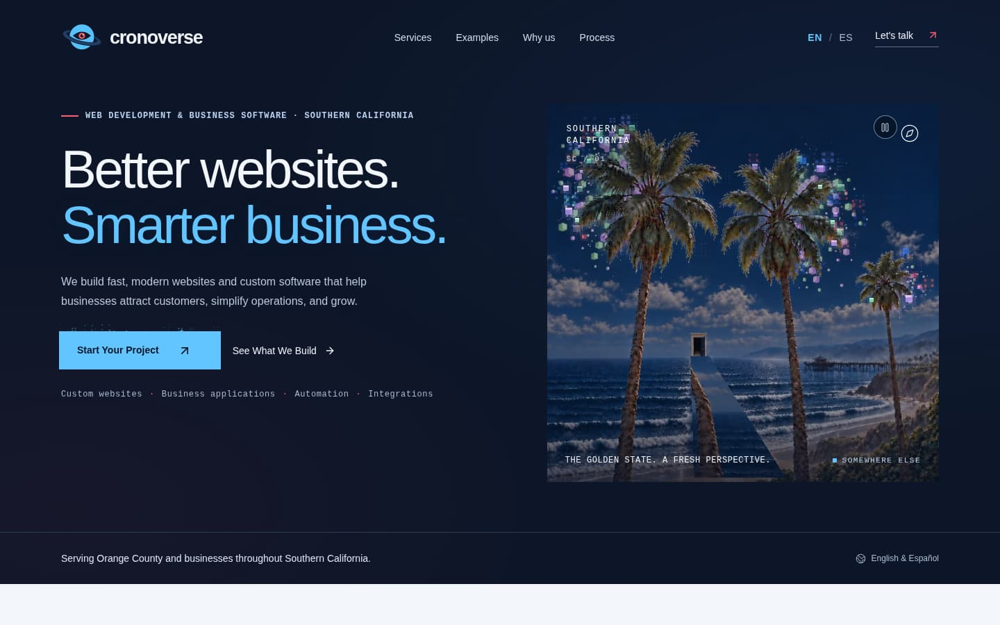
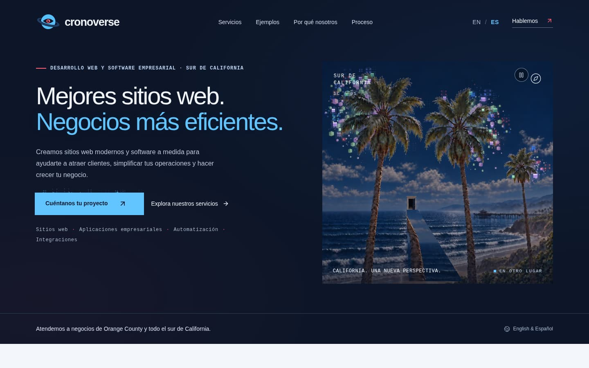
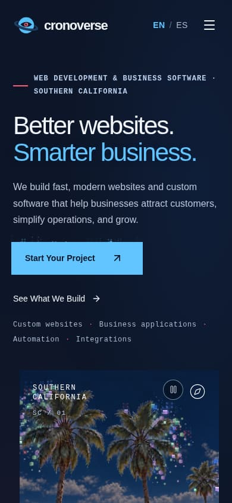
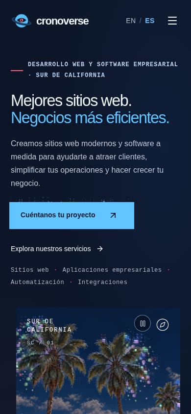
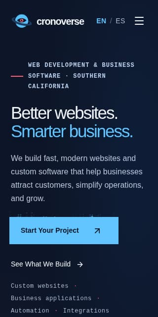
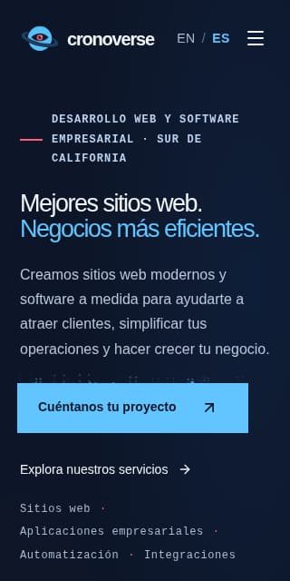

# Marketing and conversion overhaul

Branch `feat/cronoverse-marketing-overhaul`, based on `feat/frontend-django-integration`
(`2067261`, the deployed version). The visual identity, the animated hero, and all five
interactive demos are unchanged in behavior. This document records what changed, why, how it
was verified, and what still needs the owner.

## Baseline (before any change)

| Check | Result |
| --- | --- |
| `pnpm test` (proxy, analytics, captcha) | 22/22 pass |
| `pnpm typecheck` / `pnpm lint` | clean / 0 errors, 9 existing `` warnings |
| `pnpm build` | succeeds |
| Django `check`, `makemigrations --check`, `test inquiries` | clean, no pending migrations, 32 tests OK (2 PostgreSQL-only skips) |
| Live site, `https://cronoverse.online/` | No canonical URL, `robots.txt` and `sitemap.xml` return 404, English-only metadata, about 15 MB per page load |
| Live Lighthouse (mobile / desktop) | Performance 55 / 69, Accessibility 100, Best practices 100, SEO 100. Mobile LCP 25.8 s |

GA4 was already implemented: it loads only after consent and sends `generate_lead`. Its admin
reporting dashboard lives in Django. Both were kept; the new events reuse the same
consent-gated tag.

## What changed

### Message and page flow

Hero → 01 Services → 02 Interactive examples → 03 Why Cronoverse → 04 Process →
05 Contact, each with a scroll anchor (`#services`, `#examples`, `#why`, `#process`,
`#contact`) and header/footer links.

- **Hero:** the approved eyebrow, the two-line headline "Better websites. / Smarter business."
  (Spanish: "Mejores sitios web. / Negocios más eficientes."), description, primary CTA → form,
  secondary CTA → services, and the supporting service line. The headline is sized per
  breakpoint and language, so it stays on two lines from 640px up. Both CTAs are above the
  fold at 1440×900.
- **Services:** three cards (Websites, Business Software, Automation & Integrations), each with
  a description, a four-item checklist, and a CTA that opens the form with the matching service
  already selected.
- **Examples:** new heading, description, the "sample data" note, and the five
  demo-specific captions. A single CTA follows ("Need something like this? Let's build it.").
  The demos themselves are unchanged.
- **Why Cronoverse** (new navy section): the four approved value points.
- **Process** and **Contact:** the approved copy, with a form heading and required-field note.
- **Footer:** tagline, service area, languages, navigation, "Have a project? Let's talk.",
  back to top, and copyright. There were no legal pages to preserve (see *Remaining*).
- **Small screens:** a "Start Your Project" bar appears between the hero and the contact
  section. It is hidden over the hero, the form, the footer, and while the analytics banner is
  open.

No testimonials, statistics, prices, guarantees, addresses, or phone numbers were added.

### Form and backend

- The form uses five service choices. `New Website`, `Website Redesign`, and `Not Sure Yet`
  keep their stored values (`new`, `redesign`, `unsure`). `software` and `automation` are new.
- The retired `app` value ("Web app or integration") stays valid: earlier inquiries keep their
  meaning, and a page cached before the release can still submit. It appears in the admin as
  "Web app or integration (earlier form)".
- Migration `inquiries/0002` changes only the choice list. `sqlmigrate` shows a SQL no-op, and
  applying it to a database containing earlier inquiries left every row unchanged.
- Validation now runs in the browser as well as on the server, and every message is
  translated: per-field messages, `aria-invalid` and `aria-describedby`, focus on the first
  problem field, and a summary alert. The server checks (proxy and Django) are unchanged.
- Double submission is blocked by a ref, not only by the disabled button, so a fast
  double-click sends one request (verified).
- Success appears only for a 200/201 `{ok: true}` reply from Django. It receives focus and uses
  the approved bilingual message. A 400 now gets its own "review the form" message; 503,
  network failure, 429, and captcha failure behave as before. Entered details are always kept.
- Spam protection is unchanged: honeypot, per-email and per-IP limits, optional Turnstile.
  Mailjet, the email worker, the API key, and CORS/CSRF settings are untouched.

### Bilingual implementation

The page keeps a single URL per language, which is what the existing toggle already wrote to
the address bar:

- `/` serves English and is the `x-default`. `/?lang=es` serves Spanish.
- `proxy.ts` resolves the language before rendering (`?lang=` first, then the
  `cronoverse-language` cookie, then English). The layout sets `<html lang>`, and the page
  renders that language on the server. There is no flash of the other language.
- Visitors who chose Spanish before the cookie existed (localStorage only) are carried over
  once, on their first visit.
- Switching language keeps typed form input. It also updates `<html lang>`, the title, and the
  description, sets the cookie, and writes `?lang=es` to the URL (or removes it for English).
- Separate `/es/` routes were not introduced. The query-parameter URLs get distinct canonical
  URLs, hreflang links, and sitemap entries, which gives search engines one indexable URL per
  language without a routing rewrite.

### SEO

- Per-language title, description, canonical URL, hreflang (en, es, x-default), Open Graph, and
  `summary_large_image` Twitter cards. These use the approved metadata copy.
- `next.config.ts` sets `htmlLimitedBots: /.*/`. Without it, vinext streams generated metadata
  into `<body>` for most user agents, including Googlebot, and canonical or hreflang tags in the
  body are ignored. The metadata now renders in `<head>` for every request (verified with
  browser and Googlebot user agents).
- `robots.txt` allows the site, disallows `/api/`, and points to the sitemap. `sitemap.xml`
  lists both language URLs with alternates.
- JSON-LD contains `Organization` and `WebSite` only: name, URL, logo, description,
  `areaServed` (Orange County, Southern California), and `knowsLanguage`. There is no
  `LocalBusiness` or `ProfessionalService`, because those expect a street address, which the
  business has not published. The email address was left out because the site does not
  publish one.
- The page has one `<h1>` and a logical h2/h3 hierarchy. The process steps are now an `<ol>`.

### Analytics

New events go through `trackEvent()` in `lib/analytics.ts`. It sends nothing before consent,
accepts only allow-listed event names and parameters, and every value must be a short slug, so
form text cannot reach Google.

| Event | Parameters | When |
| --- | --- | --- |
| `hero_cta_click` | `cta`: `start_project`, `see_services`, `mobile_bar` | Hero CTAs and the mobile bar |
| `service_cta_click` | `service`: `new`, `software`, `automation` | Service card CTA |
| `demo_interaction` | `demo` (slug), `action`: `open` or `use` | Once per demo, per page load |
| `contact_form_start` | `form_name`: `project_inquiry` | First input, once per page load |
| `language_change` | `language` | Toggle |
| `generate_lead` | unchanged, plus the two new services | Confirmed inquiries only, deduplicated |

The Django analytics dashboard is unaffected.

### Performance and accessibility

| Change | Effect |
| --- | --- |
| Hero scenes served as WebP with `srcset` (800w / 1254w) | Hero art drops from about 12.3 MB to about 0.6 MB on mobile |
| The five hidden scenes get their `src` after the first paint | The visible evening painting no longer competes for bandwidth. Previously `loading="lazy"` did not help, because the images sit in the viewport |
| Canvas engines (palms, weather, causeway) start after load and idle (`afterFirstPaint` in `lib/motion.ts`) | Animation starts a moment after the page appears, not during hydration |
| Demo carousel and charts split into their own chunk (`next/dynamic`, client-only), with a placeholder sized to the measured height at each breakpoint | Main page chunk drops from 562 KB to 132 KB raw. CLS 0 |
| Dust canvas offset set in CSS | Removes the 0.024 CLS from the CTA effect |
| 128px brand mark replaces the 536 KB PNG in the header and footer, plus a 48px favicon and an apple-touch icon | |

Reduced motion behaves as before: a calmer animation plus the Pause/Play control. The animation
was not removed.

## Verification

All results below come from the final code on this branch, served by `pnpm build && pnpm start`
(the production Worker) against a local Django on a scratch SQLite database. The Worker
serves gzip.

| Suite | Result |
| --- | --- |
| `pnpm test` | 26/26 (proxy 9, analytics 11, captcha 6). New: every service choice, interaction-event allow-list and consent, once-per-page keys |
| `pnpm typecheck`, `pnpm lint`, `pnpm build` | clean, 0 errors (same 9 existing `` warnings), succeeds |
| Django `check`, `makemigrations --check`, `test inquiries` | clean, none pending, 33 tests OK (2 PostgreSQL-only skips). New: each service saved with its admin and email label |
| `scripts/smoke-inquiries.py` (real proxy → Django → loopback SMTP) | passed: one inquiry, two emails, no duplicate sends |
| Migration on a database with earlier inquiries (including `app`) | rows preserved, labels correct |
| Admin | login, inquiry list, service filter, and labels verified (screenshot below) |
| `scripts/qa-browser.mjs` (Chromium) | **113/113 checks pass** |

The browser checks cover:

- No horizontal overflow, one `<h1>`, correct `lang`, a two-line headline, and no runtime
  errors, for English and Spanish at 1440, 768, 390, and 320px.
- Every anchor link has a target. The hero CTAs, nav links, and service-card preselection work.
- Language switching keeps typed input and updates the URL, cookie, and metadata. Returning
  visitors get server-rendered Spanish, and the legacy localStorage preference migrates.
- Bilingual validation, with focus and ARIA states.
- A real Spanish submission end to end: one request on double-click, success only after
  Django's confirmation, focus moved to the message.
- Failure states 503, 429, 400, and `{ok: false}`: the message shows, input is kept, and no
  lead event fires.
- All six analytics events, with no personal data in any payload.
- The mobile menu (including Escape) and the mobile bar's visibility rules.
- The skip link, and keyboard operation of the service select.
- Every demo:
  - inventory: stock buttons, total, low-stock badge, search
  - landing page: coral theme, CTA toggle
  - business profile: tabs, booking slot
  - data grid: pending filter, search, sort
  - charts: period switch, hover tooltip on desktop, tap tooltip on mobile
- Reduced motion: artwork, canvases, and the pause control.

### Lighthouse 12.8.2 (local production build, simulated throttling)

| Run | Performance | Accessibility | Best practices | SEO | FCP | LCP | CLS | TBT |
| --- | --- | --- | --- | --- | --- | --- | --- | --- |
| English mobile | 96 | 100 | 100 | 100 | 2.0 s | 2.5 s | 0 | 50 ms |
| Spanish mobile | 96 | 100 | 100 | 100 | 2.0 s | 2.5 s | 0 | 40 ms |
| English desktop | 100 | 100 | 100 | 100 | 0.5 s | 0.6 s | 0 | 0 ms |
| Spanish desktop | 100 | 100 | 100 | 100 | 0.5 s | 0.5 s | 0 | 0 ms |
| *Live site before (mobile / desktop)* | *55 / 69* | *100* | *100* | *100* | | *25.8 s / 4.4 s* | | |

These scores were measured on localhost. Production adds real network latency and Caddy in
front, so re-run Lighthouse against `https://cronoverse.online/` after deploying.

### Screenshots

Desktop 1440px, English and Spanish:




Mobile 390px and 320px:






The full page, the mobile project bar, and the admin view are in
`screenshots/marketing-en-1440-full.jpg`, `marketing-es-390-full.jpg`,
`marketing-en-390-mobile-bar.jpg`, and `marketing-admin-inquiries.jpg`. Tablet views are in
`marketing-*-768-fold.jpg`.

## Deploying

Nothing was deployed. When ready:

1. Run `deploy/ship.sh --up` as described in `deploy/README.md`. The Compose `migrate` service
   applies `inquiries/0002` before the backend starts. The migration changes no tables, but take
   the usual `pg_dump` backup first.
2. No new environment variables are needed. The site URL is `https://cronoverse.online`
   (`SITE_URL` in `lib/site.ts`).
3. After deploying, check:
   ```sh
   curl -s https://cronoverse.online/robots.txt
   curl -s https://cronoverse.online/sitemap.xml
   curl -s 'https://cronoverse.online/?lang=es' | grep -o '<link rel="canonical"[^>]*>'
   ```
   Then submit the sitemap in Google Search Console and send one test inquiry.
4. In GA4 (once `GA4_MEASUREMENT_ID` is set), mark `generate_lead` as a key event. The other
   events appear automatically after visitors consent. Optionally register `cta`, `service`,
   `demo`, `action`, and `language` as custom dimensions.

## Remaining and recommended

- **Privacy policy (recommended).** The site collects inquiry details and, with consent, uses
  Google Analytics. California visitors are covered by CCPA/CPRA, and the consent banner and
  form note would normally link to a policy. No policy text was written, because it needs the
  owner's legal review.
- **Business details for structured data.** Adding a public email address, phone number, or
  social profiles to `organizationJsonLd()` in `lib/site.ts`, and to the footer, would
  strengthen the Organization entity. Do this only once they are published.
- **Remaining mobile cost.** About 175 KB of gzipped JavaScript loads before the page is
  interactive: framework 59 KB, runtime 56 KB, page 45 KB, form inputs 16 KB. The demo chunk
  (116 KB) loads after. There is also the 29 KB render-blocking stylesheet, most of it the
  vendored shadcn and Tailwind CSS. Trimming unused component CSS is the next lever if mobile scores drop in
  production.
- **Translation review.** The Spanish copy is the approved text from the brief. New strings
  (validation messages, labels, notes) were written to match its tone. A native-speaker pass on
  the new strings is still worthwhile.
- **Browser QA in CI.** `scripts/qa-browser.mjs` is not yet part of CI, because it needs a
  browser and both servers. It could run alongside the existing smoke job.
